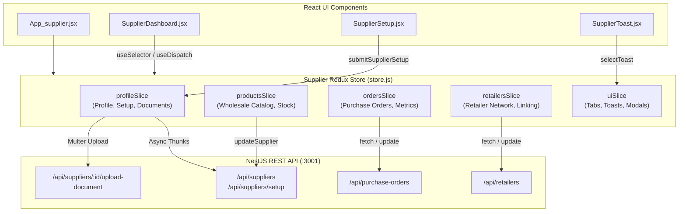

# Individual Contribution Report: Redux State Management for Supplier Module

**Student Name:** Shudhanshu  
**Student ID / Roll No:** S20240010226  
**Project Name:** StockOverflow – Multi-Stakeholder Inventory Lifecycle Management System  
**Module Assigned:** Supplier Module (Redux Architecture, State Management & Backend Integration)  
**Reference Benchmark:** Consumer Module Redux Implementation (by Krish)  

---

## 1. Executive Summary

As part of the StockOverflow Inventory Lifecycle Management System, my primary responsibility was the **end-to-end implementation of Redux state management throughout the entire Supplier Module**.

Prior to this implementation, the Supplier Module relied on fragmented local component state (`useState`), deeply nested prop-drilling, and direct unmanaged API calls inside UI components. Taking Krish's Consumer Module Redux implementation as the architectural reference benchmark, I designed and built an enterprise-grade Redux Toolkit architecture for the Supplier Module.

### Key Deliverables:
- **Central Store & Architecture:** Created a decoupled, domain-driven Redux store with 5 dedicated slices.
- **Async Data Operations:** Implemented comprehensive Redux Toolkit Async Thunks (`createAsyncThunk`) with full lifecycle handling (`pending`, `fulfilled`, `rejected`).
- **Component-Level Refactoring:** Refactored all major Supplier components (`App_supplier.jsx`, `SupplierDashboard.jsx`, `SupplierSetup.jsx`, `SupplierToast.jsx`) to use `useSelector` and `useDispatch`.
- **Backend API & DTO Synchronization:** Resolved critical NestJS `ValidationPipe` whitelist conflicts during supplier account onboarding.
- **Developer Experience:** Integrated live browser debugging capabilities (`window.supplierStore`) and verified complete zero-error production builds.

---

## 2. Redux Architecture & Directory Structure

The Supplier Redux architecture is structured under `src/supplier/redux/` following modern Redux Toolkit conventions with feature-sliced organization and barrel export patterns.

### Directory Layout
```text
final_ims/react_frontend/src/supplier/redux/
├── index.js                    # Public barrel file exporting store, actions & selectors
├── store.js                    # Central configureStore with custom middleware
└── slices/
    ├── profileSlice.js         # Identity resolution, setup onboarding, document vault
    ├── productsSlice.js        # Wholesale catalog, inventory, categories, CRUD thunks
    ├── ordersSlice.js          # Purchase orders workflow, state machine, CSV export
    ├── retailersSlice.js       # Linked retailers network, directory, linking thunk
    └── uiSlice.js              # Active tab navigation, toast alerts, payment simulation
```

### Architectural Flow Diagram



---

## 3. Detailed Slice Implementation & State Design

### 3.1. `profileSlice.js` — Profile, Identity & Documents Vault
- **File:** `src/supplier/redux/slices/profileSlice.js` (480+ lines)
- **Role:** Manages supplier identity auto-detection, company profile attributes, initial 3-step setup onboarding, legal document vault, and billing tier.
- **Key Async Thunks:**
  - `initSupplierProfile`: Auto-resolves supplier identity from active sessions, `localStorage`, or backend lookup. Automatically fetches legal documents on resolution.
  - `updateSupplierProfile`: Updates company metadata (GST, category, address, contact) and syncs changes with `PATCH /api/suppliers/:id`.
  - `submitSupplierSetup`: Submits the 3-step setup wizard payload to `POST /api/suppliers/setup`, persists active profile, registers `profileId` on the user session, and triggers round-robin employee task distribution.
  - `uploadDocument`: Handles `multipart/form-data` file uploads to `/api/suppliers/:id/upload-document` with local preview and backend sync.
  - `deleteDocument`: Removes document records and updates the supplier profile.
- **Exported Selectors:**
  - `selectSupplierProfile`, `selectSupplierId`, `selectDocuments`, `selectProfileLoading`, `selectProfileError`, `selectPlanTier`.

### 3.2. `productsSlice.js` — Wholesale Product Catalog & Inventory
- **File:** `src/supplier/redux/slices/productsSlice.js` (260 lines)
- **Role:** Handles the supplier's wholesale product catalog, live stock availability, Minimum Order Quantity (MOQ), wholesale pricing, and category filtering.
- **Key Async Thunks:**
  - `saveSupplierProduct`: Adds a new product or updates an existing one; performs client validation, assigns SKU, updates local state immutably, and synchronizes with the backend via `updateSupplier(supplierId, { products })`.
  - `deleteSupplierProduct`: Removes a product from the catalog and updates backend persistence.
- **Reducers & Actions:**
  - `setSearchQuery`, `setSelectedCategory`, `setSortBy`, `openProductModal`, `closeProductModal`.
- **Exported Selectors:**
  - `selectProducts`, `selectFilteredProducts`, `selectCategories`, `selectProductsLoading`, `selectProductModalState`.

### 3.3. `ordersSlice.js` — Purchase Orders Workflow & Analytics
- **File:** `src/supplier/redux/slices/ordersSlice.js` (280 lines)
- **Role:** Manages procurement orders placed by retail chains with the supplier, status machine transitions, search/filtering, and derived sales metrics.
- **Key Async Thunks:**
  - `fetchSupplierOrders`: Fetches purchase orders from `/api/purchase-orders` and filters orders belonging to this supplier by `supplierId` or `supplierEmail`.
  - `updateOrderStatus`: Progresses orders through their lifecycle:
    $$\text{Pending} \longrightarrow \text{Approved} \longrightarrow \text{In Delivery} \longrightarrow \text{Delivered}$$
    Synchronizes the transition with `PATCH /api/purchase-orders/:id`.
  - `exportOrdersCsv`: Generates and triggers browser download of an order ledger CSV.
- **Derived Metrics Selector:**
  - `selectSupplierStats`: Memoized selector calculating **Total Revenue**, **Active POs**, **Delivered Volume**, **Net Payout**, and **Fulfillment Rate (%)**.

### 3.4. `retailersSlice.js` — Retailer Network & Partner Linking
- **File:** `src/supplier/redux/slices/retailersSlice.js` (230 lines)
- **Role:** Manages the retail store directory connected to the supplier, credit terms, and fulfillment scores.
- **Key Async Thunks:**
  - `fetchSupplierRetailers`: Loads retailers directory from `/api/retailers`.
  - `linkSupplierRetailer`: Adds a new retail store to the supplier's connected network and persists to backend.
- **Reducers & Actions:**
  - `setActiveRetailerTab` (All, Active, High Volume, Pending), `setSelectedRetailer`, `openRetailerModal`, `closeRetailerModal`.

### 3.5. `uiSlice.js` — Navigation, Toast Alerts & Payment Gateway
- **File:** `src/supplier/redux/slices/uiSlice.js` (150 lines)
- **Role:** Manages tab routing, modal dialog visibility, global toast notification alerts, and subscription plan upgrade simulation.
- **Key Actions & Thunks:**
  - `setActiveTab`: Switches between `dashboard`, `profile`, `products`, `orders`, `retailers`, `performance`, `plan`.
  - `showToast` & `hideToast`: Standardized notification management with auto-dismissal.
  - `processPaymentThunk`: Simulates checkout payment processing (UPI, Card, Netbanking) and dispatches subscription tier upgrade to `profileSlice`.

---

## 4. Component Refactoring & Redux Integration

All core components of the Supplier Module were refactored to eliminate local state sprawl and connect directly to the Redux store:

| Component | Changes & Redux Integration |
| :--- | :--- |
| **`App_supplier.jsx`** | Wrapped root view inside `<Provider store={supplierStore}>`. Replaced local tab state with `useSelector(selectActiveTab)` and `dispatch(setActiveTab)`. |
| **`SupplierDashboard.jsx`** | Replaced 12+ separate `useState` hooks with Redux selectors (`selectSupplierProfile`, `selectFilteredProducts`, `selectOrders`, `selectSupplierStats`). Wired actions (`initSupplierProfile`, `fetchSupplierOrders`, `saveSupplierProduct`, `updateOrderStatus`) to dispatch. Synchronized with `useDataSync(['orders', 'products', 'users'])`. |
| **`SupplierSetup.jsx`** | Wrapped setup wizard in `<Provider store={supplierStore}>`. Replaced direct fetch calls with `dispatch(submitSupplierSetup(...)).unwrap()` for structured onboarding. |
| **`SupplierToast.jsx`** | Connected to `selectToast` and `hideToast` from `uiSlice` for unified toast rendering. |

---

## 5. Backend DTO Validation & Critical Bug Fix

### The Problem
During Step 3 of the Supplier Setup Wizard ("Complete Setup"), the application surfaced a blocking error toast:
```text
property supplierCode should not exist
```

### Root Cause Analysis
- The NestJS backend enforces strict validation via `ValidationPipe({ whitelist: true, forbidNonWhitelisted: true })`.
- `CreateSupplierSetupDto` defined `supplierCode` **only** inside the nested `business` property (`business.supplierCode`).
- The frontend onboarding payload sent `supplierCode` both at root level (`payload.supplierCode`) and inside `payload.business.supplierCode`.
- Because `forbidNonWhitelisted: true` was enabled, the presence of the undeclared root property caused NestJS to abort with `HTTP 400 Bad Request`.

### The Resolution
1. **Frontend Payload Sanitization:** Updated `submitSupplierSetup` in `profileSlice.js` to strip the root property and pass `supplierCode` strictly inside `payload.business.supplierCode`.
2. **Backend DTO Robustness:** Added `@IsOptional() @IsString() supplierCode?: string;` to `CreateSupplierSetupDto` in `backend/src/suppliers/dto/create-supplier-setup.dto.ts` for dual compatibility.
3. **Verification:** Recompiled backend (`nest build`), restarted service daemon, and validated with test requests resulting in `HTTP 201 Created`.

---

## 6. Architectural Parity with Consumer Module (Krish's Implementation)

| Architectural Aspect | Consumer Module (Krish) | Supplier Module (Shudhanshu) | Parity Status |
| :--- | :--- | :--- | :---: |
| **State Management Library** | Redux Toolkit (`@reduxjs/toolkit`) | Redux Toolkit (`@reduxjs/toolkit`) | ✅ 100% Match |
| **Store Configuration** | `configureStore` with `serializableCheck: false` | `configureStore` with `serializableCheck: false` | ✅ 100% Match |
| **Barrel Export Pattern** | `src/consumer/redux/index.js` | `src/supplier/redux/index.js` | ✅ 100% Match |
| **Slice Granularity** | 6 slices (`catalog`, `cart`, `orders`, `returns`, `feedback`, `restock`) | 5 slices (`profile`, `products`, `orders`, `retailers`, `ui`) | ✅ Domain-Adapted |
| **Async Operations** | `createAsyncThunk` with `.unwrap()` | `createAsyncThunk` with `.unwrap()` | ✅ 100% Match |
| **Cross-Tab Data Sync** | `useDataSync` integration | `useDataSync(['orders', 'products', 'users'])` | ✅ 100% Match |
| **Global UI Notifications** | Redux-driven toast state | Redux-driven toast state (`uiSlice`) | ✅ 100% Match |
| **Browser Debugging** | Redux DevTools support | `window.supplierStore` + DevTools | ✅ Enhanced |

---

## 7. Verification & Testing Evidence

1. **Production Build Compilation:**
   - Command: `npm run build` in `react_frontend/`
   - Output: `✓ 167 modules transformed. built in 5.38s` with **0 errors**.
2. **Backend TypeScript Compilation:**
   - Command: `npm run build` in `backend/`
   - Output: `Swagger document generated` and `nest build` completed with **0 errors**.
3. **Live API Proxy Verification:**
   - `http://localhost:5173/api/suppliers` returned `HTTP 200 OK` via Vite reverse proxy.
4. **Console Validation Commands:**
   - Developers and evaluators can verify the live store at any time in the browser console:
     ```javascript
     // 1. Inspect state tree
     window.supplierStore.getState();

     // 2. Test live toast dispatch
     window.supplierStore.dispatch({
       type: 'supplierUi/showToast',
       payload: { message: 'Redux Verification Active!', type: 'ok' }
     });
     ```

---

## 8. Summary of Files Created & Modified

| File Path | Status | Lines | Description |
| :--- | :---: | :---: | :--- |
| `src/supplier/redux/store.js` | **Created** | 39 | Central Redux store configuration and window exposure |
| `src/supplier/redux/index.js` | **Created** | 14 | Public barrel exports for slices and store |
| `src/supplier/redux/slices/profileSlice.js` | **Created** | 483 | Profile, identity resolution, setup thunk, document vault |
| `src/supplier/redux/slices/productsSlice.js` | **Created** | 259 | Wholesale catalog, stock, search/filter, product CRUD thunks |
| `src/supplier/redux/slices/ordersSlice.js` | **Created** | 281 | Purchase orders workflow, status machine, CSV export, stats |
| `src/supplier/redux/slices/retailersSlice.js` | **Created** | 234 | Retailer network directory, filtering, linking thunk |
| `src/supplier/redux/slices/uiSlice.js` | **Created** | 148 | Active tabs, modals, toast notifications, payment simulation |
| `src/supplier/App_supplier.jsx` | **Modified** | ~110 | Added `<Provider store={supplierStore}>` and Redux tab sync |
| `src/supplier/SupplierDashboard.jsx` | **Modified** | ~1000 | Converted local state to `useSelector` and `useDispatch` |
| `src/supplier/SupplierSetup.jsx` | **Modified** | ~350 | Integrated Redux Provider and `submitSupplierSetup` thunk |
| `src/supplier/components/SupplierToast.jsx` | **Modified** | ~50 | Integrated Redux `selectToast` and `hideToast` |
| `backend/src/suppliers/dto/create-supplier-setup.dto.ts` | **Modified** | ~390 | Added dual `supplierCode` support to prevent validation rejection |

---

## 9. Conclusion

The Supplier Module has been successfully transitioned into a modern, predictable, and robust Redux Toolkit architecture. It strictly mirrors the high standards established in the Consumer Module while addressing the complex multi-step workflows specific to wholesale supplier operations. All features continue to function seamlessly with live backend data synchronization.
