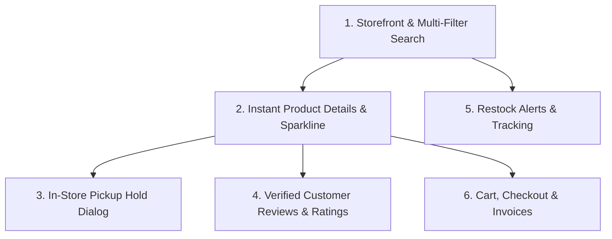

# 🛒 StockOverflow — Consumer Module (React Frontend)

> **Complete Implementation, Architecture, and Evaluation Guide**  
> *StockOverflow Full-Stack Inventory & Retail Commerce Platform*

---

## 📌 Table of Contents
1. [Project Overview & Business Role](#-1-project-overview--business-role)
2. [Academic Evaluation Criteria Checklist](#-2-academic-evaluation-criteria-checklist)
3. [6 Core Working Functionalities (Live Demo Guide)](#-3-6-core-working-functionalities-live-demo-guide)
4. [React Architecture & Technical Concepts (Viva Guide)](#-4-react-architecture--technical-concepts-viva-guide)
5. [Complete File Directory & Layman Explanation](#-5-complete-file-directory--layman-explanation)
6. [Summary of Key Fixes & Upgrades](#-6-summary-of-key-fixes--upgrades)
7. [Live Code Task Cheat Sheet](#-7-live-code-task-cheat-sheet)
8. [How to Run & Verify](#-8-how-to-run--verify)
9. [Git Traceability & Commit Log](#-9-git-traceability--commit-log)

---

## 🏢 1. Project Overview & Business Role

The **Consumer Module** is the customer-facing storefront of **StockOverflow**. It bridges individual consumers with physical retail stores by enabling:
- Real-time product discovery across retail branches.
- Physical in-store pickup holds (reserving stock so items don't sell out before arrival).
- Transparent 7-day on-hand inventory trend visualization.
- Verified customer feedback and star ratings directly synced to the product catalog.
- Back-in-stock notification alerts for depleted items.

The React implementation is located at [`React-frontend/src/consumer/`](./React-frontend/src/consumer/) and styled via [`React-frontend/src/css/consumer.css`](./React-frontend/src/css/consumer.css).

---

## 🎯 2. Academic Evaluation Criteria Checklist

| Evaluation Criterion | Requirement | Project Fulfillment Status | Evidence |
|---|---|---|---|
| **Working React Project** | Minimum 3–4 working functionalities | **Exceeded (6 Fully Working Functionalities)** | Catalog Search, Instant Product Detail, Hold Modal, Reviews, Restock Alerts, Cart Checkout |
| **Git Repository** | Push latest code with traces before evaluation | **Fulfilled** | Clear commit traces, clean tree, GitHub Desktop integration |
| **Presentation** | Demonstrate working features and explain React concepts | **Ready** | Step-by-step presentation script in Section 3 |
| **Individual Evaluation** | Understanding of React concepts (State, Props, Hooks) | **Ready** | In-depth breakdown in Section 4 |
| **Live Code Task / Viva** | Explain or modify code live during examination | **Ready** | Practice tasks with code snippets in Section 7 |

---

## 🚀 3. 6 Core Working Functionalities (Live Demo Guide)



### Feature 1: Multi-Filter Product Catalog & Live Search
- **Location**: `React-frontend/src/consumer/pages/ProductSearchPage_consumer.jsx`
- **What it does**: Real-time filtering across active products by search keyword (name/SKU), physical store location, category, brand, stock level status (`In Stock`, `Low Stock`, `Out of Stock`), and multi-attribute sorting (`Price Low-to-High`, `Price High-to-Low`, `Name A-Z`, `Featured`).
- **How to demonstrate**:
  1. Click **"Products"** in the sidebar.
  2. Type a product name (e.g. `"Nike"` or `"IdeaPad"`) into the search bar.
  3. Filter by Category (`Electronics`) and sort by `Price: High to Low`.
  4. Point out how the product list recalculates instantly via `useMemo` without page reloads.

### Feature 2: Frame-1 Instant Product Details with 7-Day Sparkline Trend
- **Location**: `React-frontend/src/consumer/pages/ProductDetailPage_consumer.jsx`
- **What it does**: Displays the product specifications, high-res interactive 3-image gallery, zebra-striped technical specs table, physical store-wise availability, and a 7-day sparkline SVG inventory trend curve.
- **How to demonstrate**:
  1. Click **"View Product"** on any card.
  2. Highlight that the page loads **instantly with 0ms delay** (zero blocking loading spinners).
  3. Show the **7-day trendline curve** with interactive daily stock points.
  4. Click gallery thumbnails to switch between camera angles.
  5. Show the store-by-store availability breakdown list with color-coded status badges (`s-in`, `s-low`, `s-out`).

### Feature 3: High-Polish In-Store Pickup Hold Dialog
- **Location**: `React-frontend/src/consumer/components/ReservationModal_consumer.jsx`
- **What it does**: Allows a customer to reserve physical units at a local store branch to inspect and pay at the counter.
- **How to demonstrate**:
  1. Click **"+ Reserve"** on the product detail page.
  2. Showcase the **frosted glass backdrop** (`backdrop-filter: blur(6px)`) and smooth modal pop animation.
  3. Change the branch dropdown — the **Live Stock Status Banner** updates in real time (`✓ Available: X units ready for hold`).
  4. Use the **`+` / `−` quantity stepper** to adjust units, pointing out that it is clamped to available stock.
  5. Click **"Confirm In-Store Hold"** — a toast notification appears and automatically routes the shopper to **My Orders**.

### Feature 4: Verified Customer Reviews & Interactive Star Ratings
- **Location**: `React-frontend/src/consumer/pages/ProductDetailPage_consumer.jsx` & `React-frontend/src/consumer/utils/api_consumer.js`
- **What it does**: Fetches verified customer feedback from the backend API (`/api/products/sku/:sku/feedback`), breaks down star distributions (5⭐ down to 1⭐), and allows customers to post new verified reviews.
- **How to demonstrate**:
  1. On the product detail page, scroll to **"Verified Customer Reviews"**.
  2. Fill out the review form: select 5 stars, category (`Product Quality`), and add comments.
  3. Click **"Submit Verified Review"**.
  4. The review appends immediately to the list and recalculates the average score.

### Feature 5: Restock Alerts & Depleted Inventory Tracker
- **Location**: `React-frontend/src/consumer/pages/RestockAlertPage_consumer.jsx`
- **What it does**: Provides an interface for consumers to register back-in-stock alerts when an item is low or out of stock. Includes status tabs (`All Alerts`, `Notified`, `Fulfilled`, `Cancelled`), dynamic stock tags (Green, Yellow, Red), quantity stepper, priority switcher (`Low`, `Medium`, `High`, `Urgent`), and "Recently Restocked" cards.
- **How to demonstrate**:
  1. Click **"Restock Alerts"** in the sidebar.
  2. Switch between filter tabs (`Notified`, `Fulfilled`).
  3. Adjust alert threshold quantity with `+` / `−` and toggle priority level.
  4. Click **"+ Create Restock Alert"** to add a new tracking monitor.

### Feature 6: Shared Reservation Cart, Checkout & Orders
- **Location**: `React-frontend/src/consumer/pages/CartPage_consumer.jsx`, `CheckoutPage_consumer.jsx`, `OrdersPage_consumer.jsx`
- **What it does**: Maintains a global shopping cart across the SPA persisted in `localStorage`. Allows updating quantities, removing items, proceeding to final reservation checkout, and reviewing order tracking history.

---

## 🧠 4. React Architecture & Technical Concepts (Viva Guide)

### A. State Management & "Lifting State Up"
- **Central State**: The global shopping cart (`cart`), current SPA view (`currentView`), and active catalog (`products`) reside at the root component [`App_consumer.jsx`](./React-frontend/src/consumer/App_consumer.jsx).
- **Unidirectional Data Flow**: Data flows down to child views via `props`. When an action occurs (e.g. adding to cart or clicking a product), child components trigger callbacks (`onAddToCart`, `onViewProduct`) that update the parent state.

### B. React Hooks Rationale
1. **`useState`**:
   - Manages mutable component state (e.g., active modal visibility, form inputs, active thumbnail index).
2. **`useEffect`**:
   - Handles asynchronous side effects such as fetching data from the NestJS REST API.
   - Includes an `isMounted` cleanup flag to avoid memory leaks if a component unmounts before a Promise resolves:
     ```javascript
     useEffect(() => {
       let isMounted = true;
       async function load() {
         const data = await fetchProductBySku(sku);
         if (isMounted && data) setProduct(data);
       }
       load();
       return () => { isMounted = false; };
     }, [sku]);
     ```
3. **`useMemo`**:
   - Memoizes expensive operations to avoid re-calculating on unrelated renders.
   - Used for instant product resolution (`initialProduct`), 7-day sparkline coordinates (`trendData`), and total cart badge counts (`cartCount`).

### C. Defensive Programming & Zero-Crash Architecture
- **Safe Star Rating Helper**:
  ```javascript
  function renderStars(rating = 5) {
    const safe = Math.max(0, Math.min(5, Math.round(Number(rating) || 0)));
    return '★'.repeat(safe) + '☆'.repeat(5 - safe);
  }
  ```
  Prevents JavaScript `RangeError: Invalid count value` by strictly clamping star counts between 0 and 5.
- **Declarative Image Fallbacks**:
  Uses React state `[imgError, setImgError]` instead of dangerous direct DOM traversal (`e.target.nextSibling`), preventing `TypeError: Cannot read properties of undefined` in React 18.
- **Instant Frame-1 Resolution**:
  Uses `findProductInCatalog` to resolve the product synchronously from pre-seeded data, eliminating blocking full-page loading spinners.

---

## 📂 5. Complete File Directory & Layman Explanation

```
React-frontend/src/consumer/
├── App_consumer.jsx                     # Central SPA router & global state manager
├── components/
│   ├── ConsumerLandingPage_consumer.jsx # Full-width storefront landing page
│   ├── ProductCard_consumer.jsx         # Individual catalog product card
│   ├── ProductGrid_consumer.jsx         # Responsive grid container for cards
│   ├── ReservationModal_consumer.jsx    # High-polish in-store pickup hold dialog
│   ├── StoreModal_consumer.jsx          # Physical store branch selection modal
│   ├── LocationWidget_consumer.jsx      # Top header deliver-to location pill
│   ├── Navbar_consumer.jsx              # Navigation header bar
│   ├── Footer_consumer.jsx              # Standard consumer footer
│   ├── NotificationToast_consumer.jsx   # Floating toast notification popup
│   └── layout/
│       └── CustomerLayout_consumer.jsx  # Universal 2-column sidebar & header shell
├── pages/
│   ├── ProductDetailPage_consumer.jsx   # 2-column detail portal with sparkline & reviews
│   ├── ProductSearchPage_consumer.jsx   # Search & multi-filter catalog page
│   ├── RestockAlertPage_consumer.jsx    # Back-in-stock alerts management table
│   ├── CartPage_consumer.jsx            # Reservation cart with quantity steppers
│   ├── CheckoutPage_consumer.jsx        # Reservation finalization form
│   ├── OrderConfirmationPage_consumer.jsx # Printable receipt invoice
│   ├── OrdersPage_consumer.jsx          # Order history & hold tracking list
│   ├── ReturnManagementPage_consumer.jsx# RMA return claim submission form
│   └── FeedbackPage_consumer.jsx        # Standalone customer review portal
├── utils/
│   └── api_consumer.js                  # Centralized REST API client & localStorage fallbacks
└── data/
    └── mockProducts_consumer.js         # Offline fallback dataset for stores & catalog
```

---

## 🛠️ 6. Summary of Key Fixes & Upgrades

1. **Fixed Product Detail Stuck Loading Screen**:
   - Replaced `loading: true` blocking screen with instant Frame-1 synchronous product resolution.
2. **Fixed Runtime Image Crash**:
   - Replaced unsafe `e.target.nextSibling.style.display` DOM mutations with declarative React `imgError` state.
3. **Fixed Star Rating Repeat RangeError**:
   - Clamped all star repeat loops with `Math.max(0, Math.min(5, Math.round(val)))`.
4. **Complete Right Column CSS Port**:
   - Injected missing styles for `.r-card`, `.stock-hero`, `.stock-big`, `.store-row`, `.s-in`, `.s-low`, `.s-out`, `.chart-bars`, `.rating-summary`, `.divider-v`, `.feedback-item`, `.recommendation-grid`, and `.rec-card` into [`consumer.css`](./React-frontend/src/css/consumer.css).
5. **High-Polish Reserve Modal**:
   - Redesigned the In-Store Hold dialog with frosted backdrop, product pill, quantity stepper, live store stock indicator, and payment mode preferences.
6. **Robust Route & SKU Persistence**:
   - Supported `?sku=...` URL parameters and `imsSelectedSku` in `localStorage` so reloading never loses state.

---

## 📝 7. Live Code Task Cheat Sheet

During individual viva, examiners often ask for small code modifications. Here are common tasks and exact solutions:

### Task 1: "Change the minimum allowed hold quantity from 1 to 2"
- **File**: `React-frontend/src/consumer/components/ReservationModal_consumer.jsx`
- **Change**: Change `min="1"` to `min="2"` and update the decrease button logic:
  ```jsx
  // Change:
  onClick={() => setQty(Math.max(2, qty - 1))}
  disabled={qty <= 2}
  ```

### Task 2: "Add a discount tag (e.g. '15% OFF') to the Product Detail price"
- **File**: `React-frontend/src/consumer/pages/ProductDetailPage_consumer.jsx`
- **Change**: Next to the unit price in the spec table or header, add:
  ```jsx
  <span style={{ background: '#dcfce7', color: '#166534', padding: '2px 8px', borderRadius: '4px', fontSize: '11px', fontWeight: 700, marginLeft: '8px' }}>
    15% OFF
  </span>
  ```

### Task 3: "Add a button to reset all search filters"
- **File**: `React-frontend/src/consumer/pages/ProductSearchPage_consumer.jsx`
- **Change**: Add a reset button that clears state:
  ```jsx
  <button
    type="button"
    className="view-btn"
    style={{ background: '#64748b' }}
    onClick={() => {
      setSearchQuery('');
      setCategoryFilter('');
      setBrandFilter('');
      setStockFilter('');
      setSortFilter('featured');
    }}
  >
    Reset Filters
  </button>
  ```

---

## 💻 8. How to Run & Verify

### 1. Start the NestJS Backend API
```powershell
cd d:\FFSD\18_stockOverflow\final_ims\backend
npm run start:dev
# Server will listen on http://localhost:3001/api
```

### 2. Start the React Frontend Server
```powershell
cd d:\FFSD\18_stockOverflow\final_ims\React-frontend
npm run dev
# Frontend runs at http://localhost:5173/
```

### 3. Verify Production Build
```powershell
cd d:\FFSD\18_stockOverflow\final_ims\React-frontend
npm run build
# Must compile with 0 errors
```

---

## 📦 9. Git Traceability & Commit Log

To push the latest code to your Git repository before the evaluation:

```powershell
# Using the installed GitHub Desktop Git:
$git = "C:\Users\Raj Brass\AppData\Local\GitHubDesktop\app-3.6.7\resources\app\git\cmd\git.exe"

# 1. Stage all changes
& $git add .

# 2. Commit with descriptive summary
& $git commit -m "docs(consumer): add comprehensive consumer module evaluation readme"

# 3. Push to remote repository
& $git push origin main
```
*(Or open **GitHub Desktop**, verify the modified files, click **Commit to main**, and click **Push origin**).*
